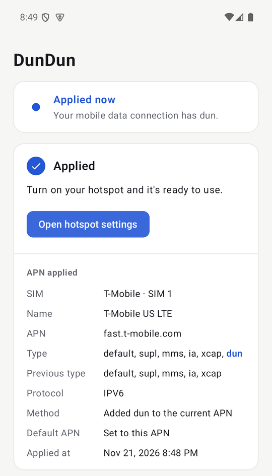

# DunDun

Lifts the tethering data cap. When your hotspot is blocked because you used up your tethering (shared) data allowance, DunDun sets up your APN so the hotspot can use your remaining regular data.
Works on Android 13 or later, including Samsung Galaxy. No PC, no root, no Shizuku.

> It doesn't give you unlimited data. The hotspot just uses your regular data instead of the tethering allowance; once your regular data runs out, your plan's speed limit still applies.

The name comes from `dun`, the APN type this app adds.

[한국어](README.md) · [Download the latest APK](https://github.com/ohseyong/dundun/releases/latest)

<p>
  
  
  
</p>

## Why

Plans often have a separate data allowance for the hotspot. Once it runs out, or you're throttled, the hotspot can get blocked even though you still have regular data. This happens a lot on Galaxy phones with One UI 7 or later.
Adding the `dun` type to the internet APN you use now sends hotspot traffic the same way as normal data, so it isn't tied to the tethering allowance.

Doing this used to mean installing DunUnlocker and Shizuku, pairing wireless debugging, and setting the APN across many screens.
This app does it in one app and four steps.

## Features

- **One app**: no Shizuku, PC, or root. The app connects to wireless debugging itself.
- **Jumps to the right settings screen**: opens Build number and Wireless debugging with one tap, and checks on its own when each is on.
- **Code entry from a notification**: keep the pairing dialog open and type the 6-digit code into the notification at the top. The notification stays up until you enter the code.
- **Works with any carrier**: copies the APN you use now and only adds `dun`. No need to pick a carrier.
- **Shows the live state**: the top of the screen says whether it is actually applied right now, and tells you right away if a carrier update undid it.
- **Shows what changed**: which SIM, which APN, and the type before and after.
- **Cleans up**: turns wireless debugging off when done.
- **Restore**: one tap puts the APN back the way it was.
- **Auto update**: checks this repo's latest release when you open the app and once a day, then downloads and installs new versions. It only installs an APK signed with the same key as the installed app. The first time you need to allow installs from this app and confirm; after that updates can install without asking. You can turn it off at the bottom of the app.
- **12 languages**: English, 한국어, 日本語, 简体中文, 繁體中文, Español, Português (Brasil), Français, Deutsch, Русский, Tiếng Việt, Bahasa Indonesia. You can also pick a language just for this app under "App languages" in phone settings.


## Install

1. Download `dundun-*.apk` from [Releases](https://github.com/ohseyong/dundun/releases/latest).
2. Open it on your phone to install. If asked, allow installing unknown apps.

Requires Android 13 or later and a Wi-Fi connection (Wi-Fi without internet works too).

## How to use

You only do this once.

1. **Turn on Developer options**: tap [Open About phone], then tap Build number 7 times in Software information.
2. **Turn on Wireless debugging**: tap [Open Wireless debugging] and turn it on. If asked, tap Allow.
3. **Enter the 6-digit code**: tap [Start code entry]. On the Wireless debugging screen tap "Pair device with pairing code", then type the number shown into [Enter code] on the notification at the top.
4. **Apply**: the app applies it and turns wireless debugging off. When you see "Applied", turn on your hotspot.

To apply again or restore, just turn on wireless debugging and tap the button in the app. You don't need a new code.

## Safety

- **Fully open source**: all code is in this repo. Anyone can read it and build it.
- **Collects no personal data**: no server, ads, or analytics. The only place the app connects to is GitHub, to check for new versions.
- **Does one thing**: the wireless debugging connection is used only to add `dun` to your current APN, and wireless debugging is turned off when done. No root needed.
- **Undo any time**: Restore original puts the APN type and default APN back.
- **Signature checked**: every version is signed with the same key, and auto update only installs files signed with it.
  - Signing certificate SHA-256: `4B:4B:E3:6B:A7:5E:D7:EA:5D:86:2D:23:8D:FC:C0:7A:10:0E:57:5C:19:49:75:05:D1:12:55:F9:17:F0:C1:66`
  - Check a downloaded APK with `apksigner verify --print-certs dundun-*.apk`. Each release lists the APK's SHA-256.

**Permissions**

| Permission | Used for |
|---|---|
| Internet | Check and download new versions from GitHub; connect to wireless debugging on the phone |
| Network and Wi-Fi state | Check Wi-Fi and whether it's applied right now |
| Wi-Fi multicast | Find the wireless debugging address on the phone |
| Notifications, full-screen notifications | Keep the pairing code notification at the top |
| Foreground service | Keep the app running while you enter the code and apply |
| Install packages, update without user action | Install new versions downloaded from GitHub. You confirm once; later updates install without asking |
| Wake lock, boot completed | Schedule the daily update check |

No contacts, location, photos/files, phone, camera, or microphone permissions.

Wireless debugging opens powerful access while it's on. DunDun turns it off when done, but if you turned it on yourself, turn it off afterwards. DunDun stays under Paired devices in wireless debugging settings; you can remove it if you won't apply or restore again.

## FAQ

**Does this make tethering unlimited?**
No. The hotspot uses your regular data instead of the tethering allowance. Once your regular data runs out, your plan's speed limit still applies to the hotspot.

**Does hotspot use still eat into my tethering/sharing allowance?**
Probably not. Hotspot traffic goes out through the same APN as normal data instead of a tethering APN, so to the carrier it looks like normal data.
This isn't guaranteed. If your carrier detects tethering another way, it may still be counted as tethering or blocked. It also uses your normal data instead, so it isn't free.
The first time, use a little data over the hotspot and check in your carrier's app which allowance went down.

**How do I know if it's applied right now?**
It's shown at the top of the app. When the APN has `dun`, the mobile data connection gets the DUN capability, and the app reads that directly. With mobile data off it can't check, so it shows the last record.

## How it works

1. The app pairs and connects to this phone's wireless debugging with [libadb-android](https://github.com/MuntashirAkon/libadb-android).
2. From that shell it starts its own worker (`ApnBroker`) with `am instrument --no-restart`.
3. The worker borrows the shell's `WRITE_APN_SETTINGS` permission (`adoptShellPermissionIdentity`), copies the default APN with `dun` added to its type, and sets it as the default.
4. It then turns wireless debugging off with `settings put global adb_wifi_enabled 0`.

Restore uses the record saved when applying (original type and original default APN).

## Notes

- Getting around tethering limits may break your carrier's terms, and your line could be restricted. Use it at your own judgment.
- The full flow (pairing, apply, restore) was tested on an Android 15 emulator. Results on real phones and carrier lines can differ. It uses standard Android features, so it works the same way regardless of brand. Please share yours in [Issues](https://github.com/ohseyong/dundun/issues).
- You may need to apply again after a carrier settings update or a reset.
- The only place the app connects to on the internet is GitHub (api.github.com, github.com), for update checks. It sends no personal data.

## Build

```bash
JAVA_HOME=/path/to/jdk-17-or-later ./gradlew :app:assembleRelease
```

The APK is at `app/build/outputs/apk/release/app-release.apk`. To sign with your own key, put a `keystore.properties` (`storeFile`, `storePassword`, `keyAlias`, `keyPassword`) in the repo root. Without it the debug key is used.

## Thanks

- [DunUnlocker](https://github.com/naijun0403/DunUnlocker): found the way to add `dun` to the APN. This app follows the same approach with new code.
- [ShutterSoundZero](https://github.com/hoons1994/ShutterSoundZero): the settings shortcuts and notification code entry flow.
- [libadb-android](https://github.com/MuntashirAkon/libadb-android), [Conscrypt](https://github.com/google/conscrypt), [Bouncy Castle](https://www.bouncycastle.org)

## Made by

The maker of [ExcelKOSPI](https://excelkospi.ai/?utm_source=dundun&utm_medium=github&utm_campaign=readme).

## License

[Apache License 2.0](LICENSE)
