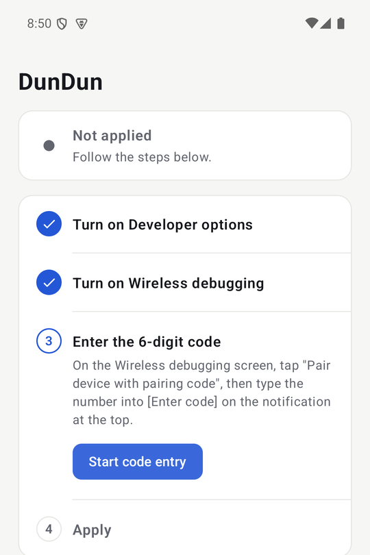
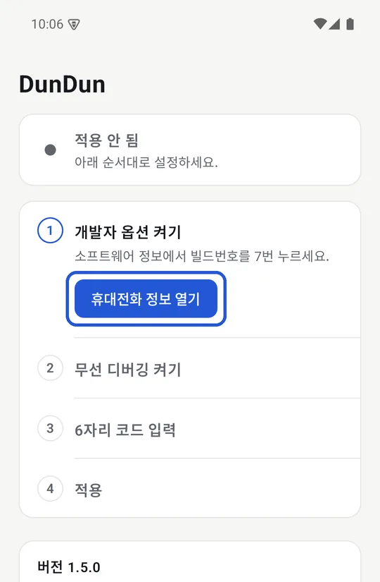
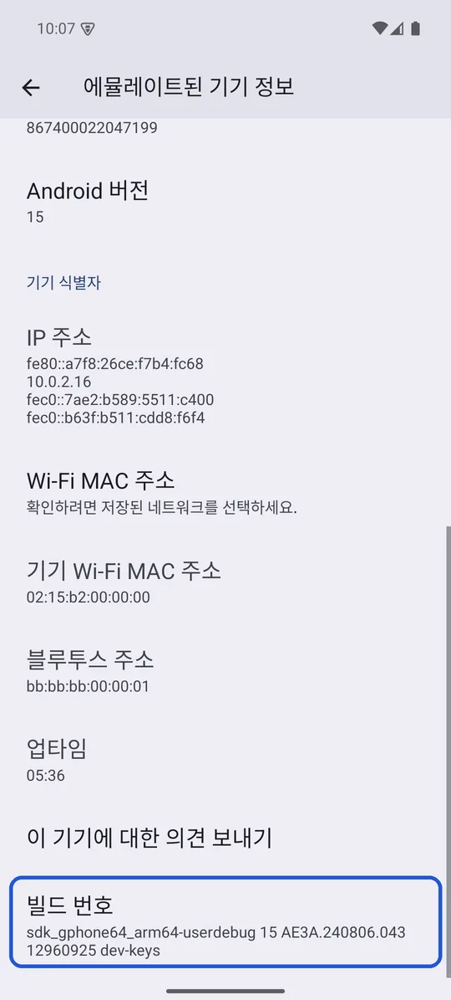
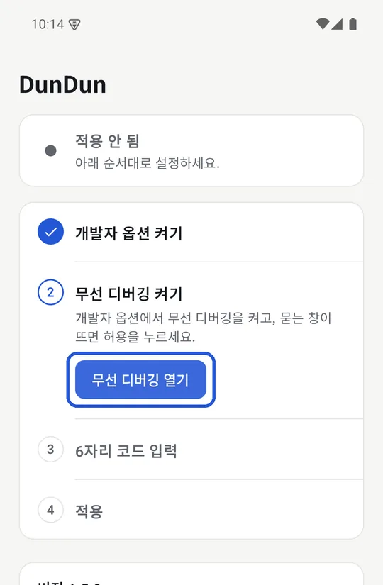
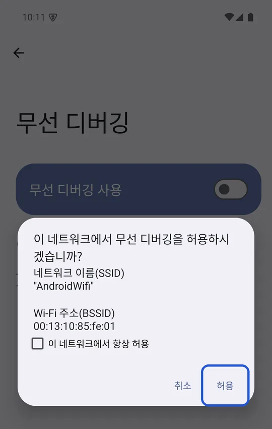
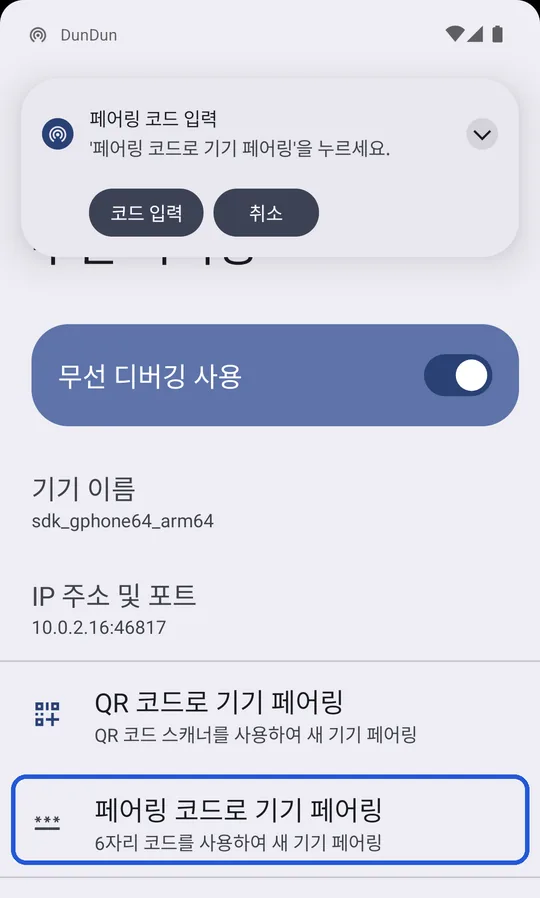
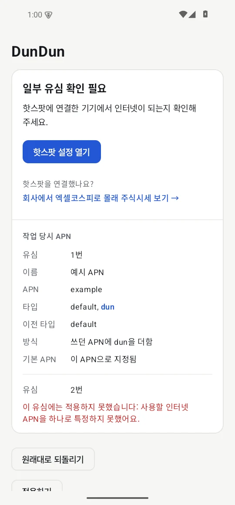

# DunDun

DunDun adjusts the mobile data APN used for Android tethering. Hotspot access and data usage depend on your device, carrier, and plan. Setup runs on the phone without a PC or root.

The name comes from `dun`, the APN type it adds.

[한국어](README.md) · [Download the latest APK](https://github.com/ohseyong/dundun/releases/latest) · [Website](https://seyong.me/dundun/en/)

<p>
  
  
  
</p>

The per-SIM result screenshot uses sample data.

## When to use it

- Your plan says unlimited, but the hotspot hits a tethering limit when you connect a laptop
- Your carrier's app says the tethering allowance is used up
- The hotspot turns on, but connected devices get no internet
- You're throttled and still want to use the hotspot at that speed

This used to mean installing DunUnlocker and Shizuku, then pairing wireless debugging and editing the APN across several screens. DunDun does it in one app, in four steps.

## Install

Download `dundun-*.apk` from [Releases](https://github.com/ohseyong/dundun/releases/latest) and open it on your phone. If it asks about installing unknown apps, allow it. You need Android 13 or later.

## How to use

1. Turn on Developer options. Tap [Open About phone] in the app, then tap Build number 7 times.
2. Turn on Wireless debugging. Tap [Open Wireless debugging], switch it on, and tap Allow if asked. You need Wi-Fi, but it doesn't need internet.
3. Tap [Start code entry] and open "Pair device with pairing code". Type the 6 digits into the notification at the top.
4. Review the APN result for each SIM. Check internet access on a device connected to your hotspot. The app tells you if wireless debugging could not be confirmed off.

You only do this once. To apply again or undo, turn on wireless debugging and tap the button. You won't need a new code.

<details>
<summary>Step-by-step screenshots (11)</summary>

Taken on an emulator (stock Android 15) set to Korean. Galaxy menus look a little different, but the order is the same. The blue box is where to tap.

**1. Turn on Developer options**

<table>
<tr><td width="33%" valign="top"><br>Open the app and tap [Open About phone].</td><td width="33%" valign="top"><br>Tap Build number 7 times. On Galaxy it is inside Software information.</td></tr>
</table>

**2. Turn on Wireless debugging**

<table>
<tr><td width="33%" valign="top"><br>Back in the app, tap [Open Wireless debugging].</td><td width="33%" valign="top"><br>In Developer options, open Wireless debugging.</td><td width="33%" valign="top"><br>Turn on Use wireless debugging.</td></tr>
<tr><td width="33%" valign="top"><br>Tap Allow. On Wi-Fi you use a lot, tick Always allow.</td></tr>
</table>

**3. Enter the code**

<table>
<tr><td width="33%" valign="top"><br>Back in the app, tap [Start code entry].</td><td width="33%" valign="top"><br>When the notification shows up, tap Pair device with pairing code.</td><td width="33%" valign="top"><br>When the 6 digits appear, tap [Enter code] in the notification. Leave the pairing dialog open.</td></tr>
<tr><td width="33%" valign="top"><br>Type the digits and send.</td></tr>
</table>

**4. Done**

<table>
<tr><td width="33%" valign="top"><br>Open the hotspot settings and check internet access on a connected device.</td></tr>
</table>

</details>

## Two SIMs

The app reports a result for each active SIM. If two SIMs share an APN, the app changes and restores that one APN once. A SIM is flagged for review when the app cannot identify its internet APN safely.

## Checking the APN

Find the current APN in Settings → Connections → Mobile networks → Access Point Names. DunDun lists the APN name and type recorded for each SIM. Starting with 1.5.2, DunDun changes the existing APN type in place. Android interprets a blank type and `*` as supporting multiple uses, so they are preserved.

## Also

- The app shows the last recorded APN result.
- New versions download from GitHub and install on their own. You allow it once, and you can turn it off at the bottom of the app.
- Available in 12 languages, including English, Korean, Japanese, Chinese and Spanish.

## Safety

- All the code is in this repo. Read it or build it yourself.
- There is no server behind it and no ads or analytics in it. The only thing the app talks to online is GitHub, when it checks for a new version.
- The app attempts to turn wireless debugging off after the operation. Turn it off in Settings if the app cannot confirm it.
- You can turn Developer options off afterwards and the APN change stays.
- Updates only install if signed with the same key. The signing certificate SHA-256 is `4B:4B:E3:6B:A7:5E:D7:EA:5D:86:2D:23:8D:FC:C0:7A:10:0E:57:5C:19:49:75:05:D1:12:55:F9:17:F0:C1:66`. Check a downloaded APK with `apksigner verify --print-certs dundun-*.apk`; each release also lists the APK's SHA-256.

These are all the permissions it asks for.

| Permission | Used for |
|---|---|
| Internet | Check and download new versions from GitHub; connect to wireless debugging on the phone |
| Network and Wi-Fi state | Check the Wi-Fi connection |
| Wi-Fi multicast | Find the wireless debugging address on the phone |
| Notifications, full-screen notifications | Keep the pairing code notification at the top |
| Foreground service | Keep the app running while you enter the code and apply |
| Install packages, update without asking | Install new versions from GitHub. Asks only the first time |
| Wake lock, boot completed | Schedule the daily update check |

It doesn't ask for contacts, location, photos or files, phone, camera, or microphone. DunDun stays under Paired devices in wireless debugging; remove it if you won't apply or restore again.

## FAQ

**Does this make tethering unlimited?**
Your plan still sets data limits and speeds.

**Will the tethering allowance stop going down?**
That depends on your carrier and plan. Check internet access on the connected device and data usage in your carrier app separately.

**How is this different from NetShare?**
NetShare shares the connection through a proxy, so you set up a proxy on the laptop and some programs can't log in. DunDun only changes the phone's APN and you use the normal hotspot, with nothing to set up on the laptop.

**Only on Galaxy?**
The app installs on Android 13 and later. Devices and carriers can restrict APN changes.

**What about One UI or carrier updates?**
Check the current APN in Settings after an update. DunDun shows the result recorded at the time of the last operation.

**Can I undo it?**
Use Restore original when the app has saved changes. The app verifies the restore and keeps recovery records if the current APN cannot be matched or restored.

## Notes

Using the hotspot past your tethering allowance may break your carrier's terms, and your line could be restricted.

The tests cover failed APN edits, repeated edits, and partial restore failures. Hotspot access and data usage have to be checked for each device, carrier, and plan.

## How it works

1. The app pairs and connects to the phone's wireless debugging with [libadb-android](https://github.com/MuntashirAkon/libadb-android).
2. From that shell it starts its own worker (`ApnBroker`) with `am instrument --no-restart`.
3. The worker borrows the shell's `WRITE_APN_SETTINGS` permission (`adoptShellPermissionIdentity`), records the original type before editing an unambiguously identified internet APN.
4. It checks that wireless debugging was turned off after the operation.

Restore compares the APN identity and type with the saved record. Verified changes are removed from the recovery record.

## Build

```bash
JAVA_HOME=/path/to/jdk-17-or-later ./gradlew :app:assembleRelease
```

The APK is at `app/build/outputs/apk/release/app-release.apk`. To sign with your own key, put a `keystore.properties` (`storeFile`, `storePassword`, `keyAlias`, `keyPassword`) in the repo root. Without it the debug key is used.

## Thanks

- [DunUnlocker](https://github.com/naijun0403/DunUnlocker) found the way to add `dun` to the APN. DunDun uses the same approach with new code.
- The settings shortcuts and notification code entry came from studying [ShutterSoundZero](https://github.com/hoons1994/ShutterSoundZero).
- Built with [libadb-android](https://github.com/MuntashirAkon/libadb-android), [Conscrypt](https://github.com/google/conscrypt) and [Bouncy Castle](https://www.bouncycastle.org).

## Also from the maker: ExcelKOSPI

Services run by the person who made DunDun (in Korean).

- 📶 [Korean MVNO plan comparison](https://excelkospi.ai/mvno?utm_source=dundun&utm_medium=github&utm_campaign=readme_en_mvno)
  If you keep running out of data, a different plan might be better. It collects official MVNO plans every 6 hours so you can compare price, data, network and perks, including the price after discounts end.
- 📊 [ExcelKOSPI](https://excelkospi.ai/?utm_source=dundun&utm_medium=github&utm_campaign=readme_en_promo)
  Korean stock prices in a sheet that looks like Excel, so you can check the market at work.

## License

[Apache License 2.0](LICENSE)
