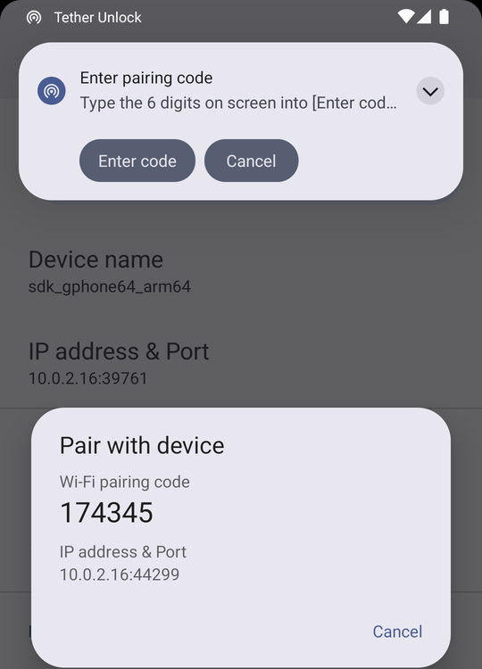
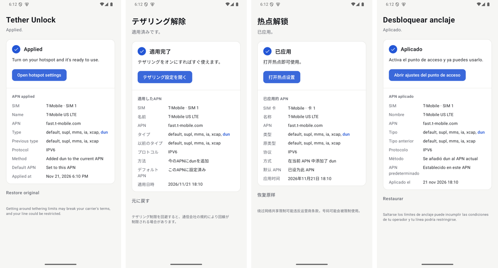

# Tether Unlock

An open-source app that lifts carrier tethering limits on Samsung Galaxy phones (One UI 7 and later), all from one app.
No PC, no root, no Shizuku.

[한국어](README.md) · [Download the latest APK](https://github.com/ohseyong/tether-free/releases/latest)

<p>
  
  
  
</p>

## Why

On Galaxy phones with One UI 7 or later, the hotspot can get blocked once your data cap is used up and you are throttled.
Adding the `dun` type to the internet APN you use now sends hotspot traffic the same way as normal data.

Doing this used to mean installing DunUnlocker and Shizuku, pairing wireless debugging, and setting the APN across many screens.
This app does it in one app and four steps.

## Features

- **One app**: no Shizuku, PC, or root. The app connects to wireless debugging itself.
- **Jumps to the right settings screen**: opens Build number and Wireless debugging with one tap, and checks on its own when each is on.
- **Code entry from a notification**: keep the pairing dialog open and type the 6-digit code into the notification at the top. The notification stays up until you enter the code.
- **Works with any carrier**: copies the APN you use now and only adds `dun`. No need to pick a carrier.
- **Shows what changed**: which SIM, which APN, and the type before and after.
- **Cleans up**: turns wireless debugging off when done.
- **Restore**: one tap puts the APN back the way it was.
- **12 languages**: English, 한국어, 日本語, 简体中文, 繁體中文, Español, Português (Brasil), Français, Deutsch, Русский, Tiếng Việt, Bahasa Indonesia. You can also pick a language just for this app under "App languages" in phone settings.



## Install

1. Download `tether-unlock-*.apk` from [Releases](https://github.com/ohseyong/tether-free/releases/latest).
2. Open it on your phone to install. If asked, allow installing unknown apps.

Requires Android 13 or later and a Wi-Fi connection (Wi-Fi without internet works too).

## How to use

You only do this once.

1. **Turn on Developer options**: tap [Open About phone], then tap Build number 7 times in Software information.
2. **Turn on Wireless debugging**: tap [Open Wireless debugging] and turn it on. If asked, tap Allow.
3. **Enter the 6-digit code**: tap [Start code entry]. On the Wireless debugging screen tap "Pair device with pairing code", then type the number shown into [Enter code] on the notification at the top.
4. **Apply**: the app applies it and turns wireless debugging off. When you see "Applied", turn on your hotspot.

To apply again or restore, just turn on wireless debugging and tap the button in the app. You don't need a new code.

## How it works

1. The app pairs and connects to this phone's wireless debugging with [libadb-android](https://github.com/MuntashirAkon/libadb-android).
2. From that shell it starts its own worker (`ApnBroker`) with `am instrument --no-restart`.
3. The worker borrows the shell's `WRITE_APN_SETTINGS` permission (`adoptShellPermissionIdentity`), copies the default APN with `dun` added to its type, and sets it as the default.
4. It then turns wireless debugging off with `settings put global adb_wifi_enabled 0`.

Restore uses the record saved when applying (original type and original default APN).

## Notes

- Getting around tethering limits may break your carrier's terms, and your line could be restricted. Use it at your own judgment.
- The full flow (pairing, apply, restore) was tested on an Android 15 emulator. Results on real Galaxy phones and carrier lines can differ. Please share yours in [Issues](https://github.com/ohseyong/tether-free/issues).
- You may need to apply again after a carrier settings update or a reset.

## Build

```bash
JAVA_HOME=/path/to/jdk-17-or-later ./gradlew :app:assembleRelease
```

The APK is at `app/build/outputs/apk/release/app-release.apk`. To sign with your own key, put a `keystore.properties` (`storeFile`, `storePassword`, `keyAlias`, `keyPassword`) in the repo root. Without it the debug key is used.

## Thanks

- [DunUnlocker](https://github.com/naijun0403/DunUnlocker): found the way to add `dun` to the APN. This app follows the same approach with new code.
- [ShutterSoundZero](https://github.com/hoons1994/ShutterSoundZero): the settings shortcuts and notification code entry flow.
- [libadb-android](https://github.com/MuntashirAkon/libadb-android), [Conscrypt](https://github.com/google/conscrypt), [Bouncy Castle](https://www.bouncycastle.org)

## License

[Apache License 2.0](LICENSE)
