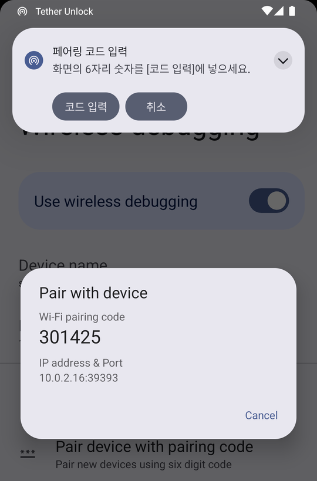
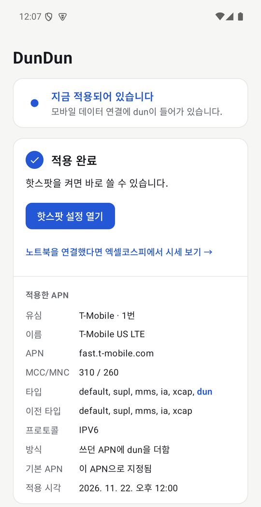

# 테더링 풀기

갤럭시(One UI 7 이상)에서 통신사 테더링 제한을 앱 하나로 푸는 오픈소스 앱입니다.
PC, 루팅, Shizuku 없이 폰 하나로 끝납니다.

[English](README.en.md) · [최신 APK 받기](https://github.com/ohseyong/tether-free/releases/latest)

<p>
  
  
  
</p>

## 왜 만들었나

One UI 7 이상 갤럭시에서는 데이터를 다 쓰고 속도 제한이 걸리면 핫스팟이 막히는 경우가 있습니다.
지금 쓰는 인터넷 APN에 `dun` 타입을 더하면 핫스팟도 일반 데이터와 같은 길로 나갑니다.

이 방법은 원래 DunUnlocker와 Shizuku를 같이 깔고, 무선 디버깅 페어링과 APN 설정을 여러 화면을 오가며 해야 했습니다.
이 앱은 그 과정을 앱 하나, 네 단계로 줄였습니다.

## 기능

- **앱 하나로 끝**: Shizuku, PC, 루팅이 필요 없습니다. 무선 디버깅 연결을 앱이 직접 합니다.
- **설정 화면으로 바로 이동**: 빌드번호, 무선 디버깅 화면을 버튼 하나로 엽니다. 켰는지는 앱이 알아서 확인합니다.
- **알림에서 코드 입력**: 페어링 창을 띄운 채 위에 뜬 알림에 6자리 코드를 넣습니다. 알림은 입력할 때까지 떠 있습니다.
- **통신사 자동**: 지금 쓰는 APN을 그대로 복사해 `dun`만 더합니다. 통신사나 알뜰폰을 고를 필요가 없습니다.
- **지금 상태 표시**: 맨 위에 지금 실제로 적용돼 있는지 보여 줍니다. 통신사 설정이 바뀌어 풀리면 바로 알려 줍니다.
- **적용 내용 표시**: 어느 유심, 어떤 APN에, 타입이 어떻게 바뀌었는지 보여 줍니다.
- **뒷정리**: 끝나면 무선 디버깅을 알아서 끕니다.
- **원래대로 되돌리기**: 버튼 하나로 APN을 처음 상태로 돌립니다.
- **자동 업데이트**: 앱을 열 때와 하루 한 번 이 저장소의 최신 릴리스를 확인해, 새 버전을 받아 설치합니다. 받은 APK가 지금 앱과 같은 키로 서명됐을 때만 설치합니다. 처음 한 번은 "이 앱의 설치 허용"과 설치 확인이 필요하고, 그 뒤로는 확인 없이 바뀔 수 있습니다. 앱 아래쪽에서 끌 수 있습니다.
- **12개 언어**: 한국어, English, 日本語, 简体中文, 繁體中文, Español, Português (Brasil), Français, Deutsch, Русский, Tiếng Việt, Bahasa Indonesia. 휴대전화 설정의 "앱 언어"에서 따로 고를 수도 있습니다.


## 설치

1. [Releases](https://github.com/ohseyong/tether-free/releases/latest)에서 `tether-unlock-*.apk`를 받습니다.
2. 폰에서 열어 설치합니다. "출처를 알 수 없는 앱" 허용을 물으면 허용합니다.

필요한 것: 안드로이드 13 이상, Wi‑Fi 연결(인터넷이 안 되는 Wi‑Fi도 됩니다).

## 사용 방법

처음 한 번만 하면 됩니다.

1. **개발자 옵션 켜기**: [휴대전화 정보 열기]를 누르고, 소프트웨어 정보에서 빌드번호를 7번 누릅니다.
2. **무선 디버깅 켜기**: [무선 디버깅 열기]를 누르고 무선 디버깅을 켭니다. 묻는 창이 뜨면 허용을 누릅니다.
3. **6자리 코드 입력**: [코드 입력 시작]을 누릅니다. 무선 디버깅 화면에서 "페어링 코드로 기기 페어링"을 누르고, 위에 뜬 알림의 [코드 입력]에 화면의 숫자를 넣습니다.
4. **적용**: 앱이 알아서 적용하고 무선 디버깅을 끕니다. "적용 완료"가 뜨면 핫스팟을 켜면 됩니다.

다시 적용하거나 되돌릴 때는 무선 디버깅만 켜고 앱의 버튼을 누르면 됩니다. 코드를 다시 넣을 필요는 없습니다.

## 자주 묻는 질문

**핫스팟을 써도 테더링(공유) 데이터가 줄지 않나요?**
그럴 가능성이 큽니다. 핫스팟 트래픽이 테더링 전용 APN 대신 일반 데이터와 같은 APN으로 나가서, 통신사에는 일반 데이터로 보이기 때문입니다.
다만 보장은 못 합니다. 통신사가 다른 방법으로 테더링을 가려내면 공유 데이터로 잡히거나 막힐 수 있습니다. 또 공유 데이터 대신 일반 데이터를 쓰는 것이라 공짜가 되는 건 아닙니다.
처음 쓸 때는 핫스팟으로 조금 써 본 뒤 통신사 앱에서 어느 쪽 사용량이 줄었는지 확인해 보세요.

**지금 적용돼 있는지는 어떻게 아나요?**
앱 맨 위에 나옵니다. APN에 `dun`이 들어가면 모바일 데이터 연결에 DUN 기능이 붙는데, 앱이 이걸 직접 읽습니다. 모바일 데이터가 꺼져 있으면 확인할 수 없어서 마지막 기록을 보여 줍니다.

## 작동 원리

1. 앱이 [libadb-android](https://github.com/MuntashirAkon/libadb-android)로 이 폰의 무선 디버깅에 직접 페어링하고 연결합니다.
2. 연결된 셸에서 `am instrument --no-restart`로 앱 안의 작업자(`ApnBroker`)를 띄웁니다.
3. 작업자는 셸의 `WRITE_APN_SETTINGS` 권한을 잠깐 빌려(`adoptShellPermissionIdentity`), 기본 APN을 복사하며 타입에 `dun`을 더하고 그 APN을 기본으로 고릅니다.
4. 끝나면 `settings put global adb_wifi_enabled 0`으로 무선 디버깅을 끕니다.

되돌리기는 적용할 때 남겨 둔 기록(원래 타입, 원래 기본 APN)으로 처음 상태를 돌려놓습니다.

## 주의

- 테더링 제한을 우회하면 통신사 약관에 어긋날 수 있고, 회선 이용이 제한될 수 있습니다. 쓰는 사람이 책임지고 판단해야 합니다.
- 안드로이드 15 에뮬레이터에서 페어링, 적용, 되돌리기 전체 흐름을 확인했습니다. 실제 갤럭시 기기와 통신사 회선에서는 기기와 통신사마다 결과가 다를 수 있습니다. 결과를 [Issues](https://github.com/ohseyong/tether-free/issues)에 남겨 주시면 반영하겠습니다.
- 통신사 설정 업데이트나 초기화 뒤에는 다시 적용해야 할 수 있습니다.
- 앱이 인터넷에 접속하는 곳은 업데이트 확인용 GitHub(api.github.com, github.com)뿐입니다. 개인 정보는 보내지 않습니다.

## 직접 빌드

```bash
JAVA_HOME=/path/to/jdk-17-or-later ./gradlew :app:assembleRelease
```

결과물은 `app/build/outputs/apk/release/app-release.apk`입니다. 서명 키를 쓰려면 저장소 루트에 `keystore.properties`(`storeFile`, `storePassword`, `keyAlias`, `keyPassword`)를 두세요. 없으면 디버그 키로 서명합니다.

## 감사

- [DunUnlocker](https://github.com/naijun0403/DunUnlocker): APN에 `dun`을 더하는 방법을 먼저 찾았습니다. 이 앱은 같은 방법을 따르되 코드는 새로 썼습니다.
- [셔터사운드 제로](https://github.com/hoons1994/ShutterSoundZero): 설정 화면 바로 이동, 알림 코드 입력 흐름을 참고했습니다.
- [libadb-android](https://github.com/MuntashirAkon/libadb-android), [Conscrypt](https://github.com/google/conscrypt), [Bouncy Castle](https://www.bouncycastle.org)

## 라이선스

[Apache License 2.0](LICENSE)
