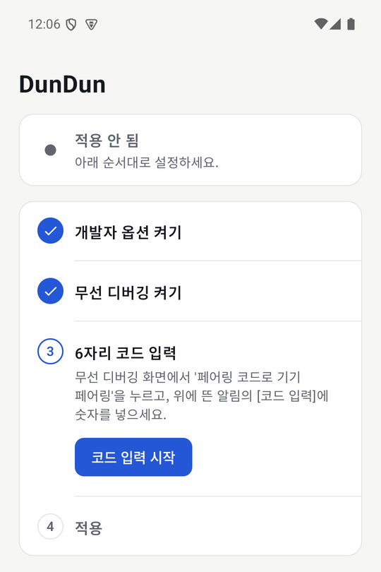

# DunDun

공유데이터를 다 써서 노트북이 핫스팟에 안 붙을 때 쓰는 안드로이드 앱이에요. APN에 `dun`을 넣어서 핫스팟이 남은 일반 데이터로 나가게 해요. PC에 연결하거나 루팅할 필요 없이 폰에서 다 끝나요.

데이터가 늘어나지는 않아요. 핫스팟도 일반 데이터에서 빠지고, 일반 데이터를 다 쓰면 요금제에 적힌 속도로 느려져요.

이름 DunDun(던던)은 APN에 넣는 `dun`에서 따왔어요.

[English](README.en.md) · [최신 APK 받기](https://github.com/ohseyong/dundun/releases/latest) · [소개 페이지](https://seyong.me/dundun/)

<p>
  
  
  
</p>

## 이럴 때 써요

- 데이터 무제한 요금제인데 노트북을 핫스팟에 붙이면 테더링 한도에 걸릴 때
- T월드 같은 통신사 앱에 공유데이터가 소진됐다고 나올 때
- 알뜰폰에서 핫스팟은 켜지는데 붙인 기기에서 인터넷이 안 될 때
- 데이터를 다 써서 느려졌는데, 그 속도로라도 핫스팟을 쓰고 싶을 때

예전에는 DunUnlocker와 Shizuku를 같이 깔고 무선 디버깅 페어링과 APN 설정을 여러 화면에서 따로 해야 했어요. DunDun은 이걸 앱 하나에서 네 단계로 끝내요.

## 설치

[Releases](https://github.com/ohseyong/dundun/releases/latest)에서 `dundun-*.apk`를 받아서 폰에서 열면 돼요. 출처를 알 수 없는 앱을 허용할지 물으면 허용하세요. 안드로이드 13 이상이 필요해요.

## 쓰는 법

1. 개발자 옵션을 켜요. 앱에서 [휴대전화 정보 열기]를 누르고 소프트웨어 정보의 빌드번호를 7번 누르면 돼요.
2. 무선 디버깅을 켜요. [무선 디버깅 열기]를 눌러서 켜고, 허용할지 물으면 허용을 눌러요. 와이파이에 붙어 있어야 하는데 인터넷이 안 되는 와이파이도 괜찮아요.
3. [코드 입력 시작]을 누르고 '페어링 코드로 기기 페어링'을 띄워요. 화면 위에 뜬 알림에 6자리 숫자를 넣으면 돼요.
4. 앱이 APN을 바꾸고 무선 디버깅을 꺼요. '적용 완료'가 뜨면 핫스팟을 켜면 돼요.

처음 한 번만 하면 돼요. 나중에 다시 적용하거나 되돌릴 때는 무선 디버깅만 켜고 버튼을 누르면 되고, 코드는 다시 안 넣어도 돼요.

## 유심이 두 개라면

유심 두 개 모두에 `dun`을 넣고, 둘 다 그 APN을 기본으로 골라 둬요. 데이터 유심을 바꿔도 다시 할 필요가 없어요. 되돌리기도 유심마다 따로 해서 다른 유심 설정은 건드리지 않아요.

## 바뀐 APN 확인하기

설정 → 연결 → 모바일 네트워크 → 액세스 포인트 이름에서 선택돼 있는 APN이 DunDun이 바꾼 거예요. 눌러 보면 APN 유형 끝에 `dun`이 붙어 있어요.

폰에 따라 원래 APN에 `dun`만 붙기도 하고, 이름이 같은 APN이 하나 더 생기기도 해요. 헷갈리면 유형에 `dun`이 있는 쪽을 보면 돼요. 통신사가 넣어 둔 Tethering 같은 APN은 건드리지 않아요. 앱의 적용 완료 화면에도 유심마다 바뀐 APN 이름과 유형이 나와요.

## 그 밖에

- 앱 맨 위에 지금 적용돼 있는지 나와요. 통신사 설정이 바뀌어서 풀리면 바로 보여요.
- 새 버전이 나오면 GitHub에서 받아서 알아서 설치해요. 처음 한 번만 설치를 허용하면 그다음부터는 묻지 않아요. 앱 아래쪽에서 끌 수 있어요.
- 한국어, 영어, 일본어, 중국어, 스페인어 등 12개 언어로 나와요.

## 안전

- 소스는 전부 이 저장소에 있어요. 직접 읽어 보고 빌드해서 써도 돼요.
- 따로 돌리는 서버가 없고, 광고나 분석 도구도 넣지 않았어요. 앱이 인터넷에 붙는 건 GitHub에서 새 버전을 확인할 때뿐이에요.
- 무선 디버깅은 APN을 바꾸는 데만 쓰고 끝나면 앱이 바로 꺼요. 무선 디버깅이 켜져 있으면 은행이나 공공기관 앱이 안 열리기도 하는데, 따로 끄러 갈 필요가 없어요.
- 다 하고 나서 개발자 옵션을 꺼도 바꾼 APN은 그대로 남아요.
- 업데이트는 같은 키로 서명된 파일만 설치해요. 서명 인증서 SHA-256은 `4B:4B:E3:6B:A7:5E:D7:EA:5D:86:2D:23:8D:FC:C0:7A:10:0E:57:5C:19:49:75:05:D1:12:55:F9:17:F0:C1:66`이에요. 받은 APK는 `apksigner verify --print-certs dundun-*.apk`로 확인할 수 있고, 릴리스마다 APK 파일의 SHA-256도 적어 둬요.

요청하는 권한은 이게 전부예요.

| 권한 | 쓰는 곳 |
|---|---|
| 인터넷 | GitHub에서 새 버전 확인하고 받기, 폰 안의 무선 디버깅에 연결하기 |
| 네트워크와 와이파이 상태 | 와이파이에 붙어 있는지, 지금 적용돼 있는지 확인하기 |
| 와이파이 멀티캐스트 | 폰 안에서 무선 디버깅 주소 찾기 |
| 알림, 전체 화면 알림 | 페어링 코드 넣는 알림을 화면 위에 계속 띄워 두기 |
| 포그라운드 서비스 | 코드를 넣고 적용하는 동안 앱이 꺼지지 않게 하기 |
| 앱 설치, 확인 없이 업데이트 | GitHub에서 받은 새 버전 설치하기. 처음 한 번만 물어봐요 |
| 절전 해제, 부팅 완료 | 하루 한 번 새 버전 확인 예약하기 |

연락처, 위치, 사진이나 파일, 전화, 카메라, 마이크 권한은 요청하지 않아요. 무선 디버깅 설정의 '페어링된 기기'에 DunDun이 남는데, 다시 적용하거나 되돌릴 일이 없으면 지워도 돼요.

## 자주 묻는 질문

**테더링을 무제한으로 쓸 수 있게 되나요?**
아니요. 핫스팟이 공유데이터 대신 일반 데이터를 써요. 일반 데이터를 다 쓰면 요금제에 정해진 속도로 느려지고, 핫스팟도 그 속도로 써야 해요.

**공유데이터는 이제 안 줄어드나요?**
보통은 안 줄어요. 통신사는 대개 APN을 보고 핫스팟을 구분하는데, 이제 핫스팟도 일반 데이터와 같은 APN으로 나가거든요. 통신사가 다른 방법으로 구분하면 그대로 잡히거나 막힐 수도 있어요. 처음엔 조금 써 보고 통신사 앱에서 어느 쪽이 줄었는지 확인해 보세요.

**NetShare랑 뭐가 달라요?**
NetShare는 프록시로 인터넷을 나눠 줘서 노트북에 프록시를 잡아야 하고, 카톡 PC처럼 로그인이 안 되는 프로그램도 있어요. DunDun은 폰의 APN만 바꾸고 핫스팟은 원래 쓰던 대로 써요. 노트북에서 손댈 건 없어요.

**갤럭시에서만 되나요?**
안드로이드 13 이상이면 돼요. 갤럭시 One UI 7 이상에서 이 문제를 겪는 분이 많아서 갤럭시로 먼저 맞춰 봤어요. APN은 안드로이드 공통 설정이라 다른 폰에서도 같은 방법으로 바꿔요.

**One UI나 통신사 설정이 업데이트되면요?**
풀리거나 막힐 수 있어요. 앱 맨 위에 지금 적용돼 있는지 나오니까, 풀렸으면 다시 적용하면 돼요. 업데이트로 아예 막히면 [Issues](https://github.com/ohseyong/dundun/issues)에 알려 주세요.

**원래대로 되돌릴 수 있나요?**
네. '원래대로 되돌리기'를 누르면 APN 유형과 기본 APN이 처음 상태로 돌아가요. 유심이 두 개면 둘 다 돌려요.

## 주의

공유데이터 한도를 넘겨서 핫스팟을 쓰는 건 통신사 약관에 어긋날 수 있어요. 회선 이용이 제한될 수도 있으니 알고 쓰세요.

안드로이드 15 에뮬레이터에서 페어링부터 적용, 되돌리기까지 확인했어요. 실제 폰과 통신사 회선에서는 결과가 다를 수 있으니, 써 보신 결과를 [Issues](https://github.com/ohseyong/dundun/issues)에 남겨 주시면 반영할게요.

## 어떻게 동작하나요

1. 앱이 [libadb-android](https://github.com/MuntashirAkon/libadb-android)로 폰의 무선 디버깅에 직접 페어링하고 연결해요.
2. 연결된 셸에서 `am instrument --no-restart`로 앱 안의 작업자(`ApnBroker`)를 띄워요.
3. 작업자는 셸이 가진 `WRITE_APN_SETTINGS` 권한을 잠깐 빌려서(`adoptShellPermissionIdentity`) 쓰고 있는 유심마다 기본 APN에 `dun`을 넣고, 그 APN을 기본으로 골라요.
4. 마지막으로 `settings put global adb_wifi_enabled 0`으로 무선 디버깅을 꺼요.

되돌릴 때는 적용할 때 유심마다 남겨 둔 기록(원래 유형, 원래 기본 APN)으로 돌려놔요.

## 직접 빌드

```bash
JAVA_HOME=/path/to/jdk-17-or-later ./gradlew :app:assembleRelease
```

결과물은 `app/build/outputs/apk/release/app-release.apk`예요. 자기 키로 서명하려면 저장소 루트에 `keystore.properties`(`storeFile`, `storePassword`, `keyAlias`, `keyPassword`)를 두세요. 없으면 디버그 키로 서명해요.

## 고마운 곳

- [DunUnlocker](https://github.com/naijun0403/DunUnlocker)가 APN에 `dun`을 넣는 방법을 먼저 찾았어요. DunDun은 같은 방법을 쓰고 코드는 새로 썼어요.
- 설정 화면으로 바로 보내는 흐름과 알림으로 코드를 받는 방식은 [셔터사운드 제로](https://github.com/hoons1994/ShutterSoundZero)를 보고 배웠어요.
- [libadb-android](https://github.com/MuntashirAkon/libadb-android), [Conscrypt](https://github.com/google/conscrypt), [Bouncy Castle](https://www.bouncycastle.org)를 써요.

## 엑셀코스피도 만들었어요

DunDun을 만든 사람이 같이 운영하는 서비스예요.

- 📶 [알뜰폰 요금제 비교](https://excelkospi.ai/mvno?utm_source=dundun&utm_medium=github&utm_campaign=readme_mvno)
  공유데이터가 자주 모자라면 요금제를 바꾸는 게 나을 수도 있어요. 알뜰폰 통신사 공식 요금제를 6시간마다 모아서 가격과 데이터, 통신망, 혜택으로 골라 볼 수 있어요. 할인 끝난 뒤 요금이랑 1년 동안 내는 돈도 같이 나와요.
- 📊 [엑셀코스피](https://excelkospi.ai/?utm_source=dundun&utm_medium=github&utm_campaign=readme_promo)
  회사에서 엑셀 보는 척하면서 주식 시세를 보는 사이트예요. 노트북을 핫스팟에 붙였다면 한번 열어 보세요.

## 라이선스

[Apache License 2.0](LICENSE)
