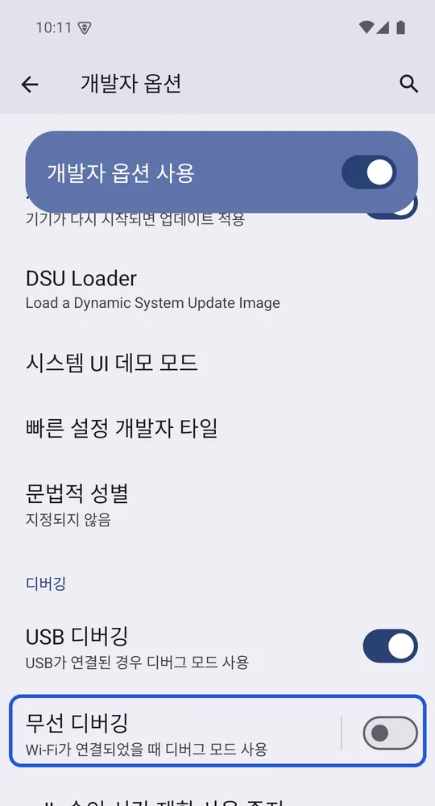
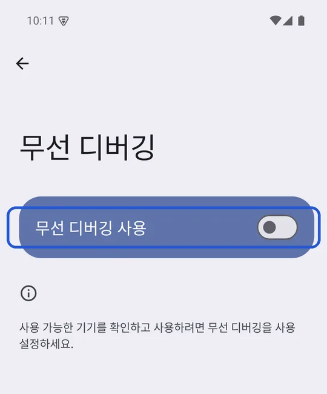
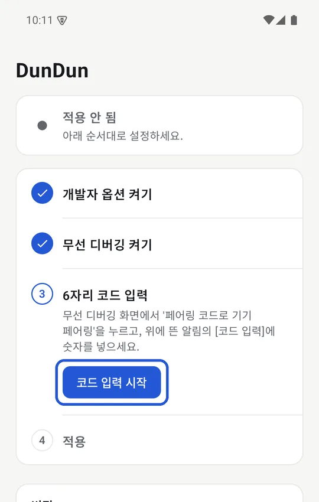
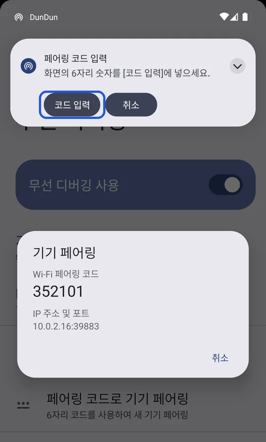
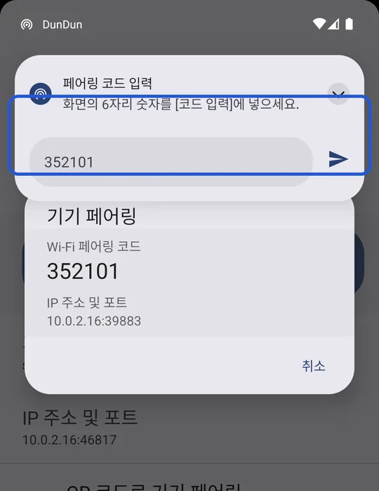

# DunDun

DunDun은 안드로이드의 핫스팟용 모바일 데이터 설정(APN)을 조정하는 앱이에요. 핫스팟 연결과 데이터 차감은 기기, 통신사, 요금제에 따라 달라요. PC 연결과 루팅 없이 휴대전화에서 설정해요.

이름 DunDun(던던)은 APN에 추가하는 `dun`에서 따왔습니다.

[English](README.en.md) · [최신 APK 받기](https://github.com/ohseyong/dundun/releases/latest) · [소개 페이지](https://seyong.me/dundun/)

<p>
  
  
  
</p>

유심별 결과 화면은 예시 데이터로 촬영했어요.

## 이럴 때 씁니다

- 무제한 요금제인데 노트북을 핫스팟에 연결하면 테더링 한도에 걸리는 경우
- 통신사 앱에 공유데이터가 소진됐다고 표시되는 경우
- 알뜰폰에서 핫스팟은 켜지지만 연결한 기기에서 인터넷이 안 되는 경우
- 데이터를 다 써서 속도 제한이 걸린 상태에서도 핫스팟을 쓰려는 경우

기존에는 DunUnlocker와 Shizuku를 함께 설치하고 무선 디버깅 페어링과 APN 설정을 여러 화면에서 따로 해야 했습니다. DunDun은 이 과정을 앱 하나, 4단계로 줄였습니다.

## 설치

[Releases](https://github.com/ohseyong/dundun/releases/latest)에서 `dundun-*.apk`를 받아 폰에서 엽니다. 출처를 알 수 없는 앱 설치를 묻는 경우 허용합니다. 안드로이드 13 이상이 필요합니다.

## 사용 방법

1. 개발자 옵션 켜기: 앱에서 [휴대전화 정보 열기]를 누르고 빌드번호를 7번 누릅니다.
2. 무선 디버깅 켜기: [무선 디버깅 열기]를 눌러 켜고, 허용 여부를 물으면 허용합니다. 와이파이 연결이 필요하며 인터넷이 되지 않는 와이파이도 괜찮습니다.
3. 코드 입력: [코드 입력 시작]을 누르고 '페어링 코드로 기기 페어링'을 엽니다. 화면 위 알림에 6자리 코드를 입력합니다.
4. 앱에서 유심별 APN 확인 결과를 봐요. 핫스팟에 연결한 기기에서 인터넷이 되는지 확인해 주세요. 무선 디버깅 종료를 확인하지 못하면 앱이 알려 줘요.

페어링은 처음 한 번만 하면 됩니다. 이후 다시 적용하거나 되돌릴 때는 무선 디버깅만 켜고 버튼을 누르면 됩니다.

<details>
<summary>단계별 스크린샷 (11장)</summary>

순정 안드로이드 15 에뮬레이터 화면입니다. 갤럭시는 메뉴 모양이 조금 다르지만 순서는 같습니다. 파란 상자가 누를 위치입니다.

**1. 개발자 옵션 켜기**

<table>
<tr><td width="33%" valign="top"><br>앱에서 [휴대전화 정보 열기]를 누릅니다.</td><td width="33%" valign="top"><br>빌드 번호를 7번 연속으로 누릅니다. 갤럭시는 소프트웨어 정보 안에 있습니다.</td></tr>
</table>

**2. 무선 디버깅 켜기**

<table>
<tr><td width="33%" valign="top"><br>앱으로 돌아와 [무선 디버깅 열기]를 누릅니다.</td><td width="33%" valign="top"><br>개발자 옵션에서 무선 디버깅 항목을 누릅니다.</td><td width="33%" valign="top"><br>무선 디버깅 사용을 켭니다.</td></tr>
<tr><td width="33%" valign="top"><br>허용을 누릅니다. 자주 쓰는 와이파이라면 '항상 허용'을 체크합니다.</td></tr>
</table>

**3. 코드 입력**

<table>
<tr><td width="33%" valign="top"><br>앱으로 돌아와 [코드 입력 시작]을 누릅니다.</td><td width="33%" valign="top"><br>알림이 뜨면 페어링 코드로 기기 페어링을 누릅니다.</td><td width="33%" valign="top"><br>6자리 코드가 표시되면 알림의 [코드 입력]을 누릅니다. 페어링 창은 닫지 않습니다.</td></tr>
<tr><td width="33%" valign="top"><br>코드를 입력하고 보내기를 누릅니다.</td></tr>
</table>

**4. 완료**

<table>
<tr><td width="33%" valign="top"><br>[핫스팟 설정 열기]에서 핫스팟을 켜고 연결한 기기의 인터넷을 확인해요.</td></tr>
</table>

</details>

## 유심이 두 개인 경우

활성 유심마다 결과를 표시해요. 여러 유심이 같은 APN을 쓰면 변경과 복구는 APN 한 건으로 처리해요. 유심의 인터넷 APN을 특정하기 어려우면 그 유심은 확인 필요로 표시해요.

## 변경된 APN 확인

설정 → 연결 → 모바일 네트워크 → 액세스 포인트 이름에서 현재 APN을 확인해요. 앱에는 작업 당시 각 유심의 APN 이름과 유형이 표시돼요. 1.5.2부터는 기존 APN 유형만 바꿔요. 빈 유형과 `*`는 Android가 여러 용도를 지원하는 값으로 해석하므로 유지해요.

## 그 밖의 기능

- 앱에는 마지막으로 확인한 APN 작업 결과가 표시돼요.
- 새 버전은 GitHub에서 받아 자동으로 설치합니다. 설치 허용은 처음 한 번만 묻고, 앱 하단에서 끌 수 있습니다.
- 한국어, 영어, 일본어, 중국어, 스페인어 등 12개 언어를 지원합니다.

## 안전

- 소스 코드는 이 저장소에 모두 공개되어 있습니다.
- 별도 서버, 광고, 분석 도구가 없습니다. 앱이 외부와 통신하는 경우는 GitHub에서 새 버전을 확인할 때뿐입니다.
- 앱은 작업 종료 시 무선 디버깅을 끄고 확인해요. 종료가 확인되지 않으면 설정에서 직접 꺼 주세요.
- 적용 후 개발자 옵션을 꺼도 변경된 APN은 유지됩니다.
- 업데이트는 같은 키로 서명된 파일만 설치합니다. 서명 인증서 SHA-256은 `4B:4B:E3:6B:A7:5E:D7:EA:5D:86:2D:23:8D:FC:C0:7A:10:0E:57:5C:19:49:75:05:D1:12:55:F9:17:F0:C1:66`입니다. 받은 APK는 `apksigner verify --print-certs dundun-*.apk`로 확인할 수 있으며, 릴리스마다 APK의 SHA-256도 함께 적습니다.

요청 권한은 다음이 전부입니다.

| 권한 | 용도 |
|---|---|
| 인터넷 | GitHub 업데이트 확인과 다운로드, 폰 내부 무선 디버깅 연결 |
| 네트워크와 와이파이 상태 | 와이파이 연결 확인 |
| 와이파이 멀티캐스트 | 폰 내부 무선 디버깅 주소 검색 |
| 알림, 전체 화면 알림 | 페어링 코드 입력 알림을 화면 위에 유지 |
| 포그라운드 서비스 | 코드 입력과 적용 중 앱 종료 방지 |
| 앱 설치, 확인 없이 업데이트 | GitHub에서 받은 새 버전 설치(처음 한 번만 확인) |
| 절전 해제, 부팅 완료 | 하루 한 번 업데이트 확인 예약 |

연락처, 위치, 사진과 파일, 전화, 카메라, 마이크 권한은 요청하지 않습니다. 무선 디버깅의 페어링된 기기 목록에 DunDun이 남으며, 다시 적용하거나 되돌릴 일이 없으면 삭제해도 됩니다.

## 자주 묻는 질문

**테더링을 무제한으로 쓸 수 있나요?**
데이터 한도와 제한 속도는 가입한 요금제를 따라요.

**적용 후에는 공유데이터가 차감되지 않나요?**
통신사와 요금제에 따라 달라요. 핫스팟에 연결한 기기의 인터넷과 통신사 앱의 데이터 차감 내역을 각각 확인해 주세요.

**NetShare와 무엇이 다른가요?**
NetShare는 프록시 방식이라 노트북에 프록시를 설정해야 하고, 카카오톡 PC처럼 로그인되지 않는 프로그램도 있습니다. DunDun은 폰의 APN만 바꾸므로 기본 핫스팟을 그대로 쓰며, 노트북에서는 설정할 것이 없습니다.

**갤럭시에서만 되나요?**
안드로이드 13 이상에서 설치할 수 있어요. 제조사와 통신사가 APN 변경을 제한할 수 있어요.

**One UI나 통신사 설정이 업데이트되면 어떻게 되나요?**
업데이트 후에는 시스템 설정에서 현재 APN을 확인해 주세요. 앱에는 마지막 작업 당시 결과가 표시돼요.

**원래대로 되돌릴 수 있나요?**
앱에서 저장한 변경이 있으면 [원래대로 되돌리기]를 누를 수 있어요. 앱이 복구 결과를 다시 읽어 확인해요. 이전 기록과 현재 APN이 다르면 복구 기록을 남기고 설정에서 확인하도록 안내해요.

## 주의

공유데이터 한도를 넘겨 핫스팟을 쓰는 것은 통신사 약관에 어긋날 수 있으며, 회선 이용이 제한될 수 있습니다.

APN 적용 실패와 재적용, 일부 복구 실패를 테스트로 확인해요. 실회선의 핫스팟 연결과 데이터 차감은 기기·통신사·요금제별 확인이 필요해요.

## 동작 원리

1. 앱이 [libadb-android](https://github.com/MuntashirAkon/libadb-android)로 폰의 무선 디버깅에 직접 페어링하고 연결합니다.
2. 연결된 셸에서 `am instrument --no-restart`로 앱 내부 작업자(`ApnBroker`)를 실행합니다.
3. 작업자는 셸의 `WRITE_APN_SETTINGS` 권한을 일시적으로 위임받아(`adoptShellPermissionIdentity`) 인터넷 APN을 하나로 특정한 뒤 변경 직전의 APN 유형을 저장하고 기존 APN 유형을 조정해요.
4. 마지막으로 무선 디버깅 종료를 확인해요.

복구 시 APN의 식별 정보와 유형을 비교해요. 원래 값이 확인된 변경만 기록에서 지워요.

## 직접 빌드

```bash
JAVA_HOME=/path/to/jdk-17-or-later ./gradlew :app:assembleRelease
```

결과물은 `app/build/outputs/apk/release/app-release.apk`입니다. 자체 키로 서명하려면 저장소 루트에 `keystore.properties`(`storeFile`, `storePassword`, `keyAlias`, `keyPassword`)를 둡니다. 없으면 디버그 키로 서명합니다.

## 참고한 프로젝트

- [DunUnlocker](https://github.com/naijun0403/DunUnlocker): APN에 `dun`을 추가하는 방법을 처음 찾은 프로젝트입니다. DunDun은 같은 방법을 쓰되 코드는 새로 작성했습니다.
- [셔터사운드 제로](https://github.com/hoons1994/ShutterSoundZero): 설정 화면 바로가기와 알림 코드 입력 방식을 참고했습니다.
- [libadb-android](https://github.com/MuntashirAkon/libadb-android), [Conscrypt](https://github.com/google/conscrypt), [Bouncy Castle](https://www.bouncycastle.org)를 사용합니다.

## 엑셀코스피의 다른 서비스

DunDun 개발자가 운영하는 서비스입니다.

- 📶 [알뜰폰 요금제 비교](https://excelkospi.ai/mvno?utm_source=dundun&utm_medium=github&utm_campaign=readme_mvno)
  공유데이터가 자주 부족하다면 요금제를 바꾸는 것도 방법입니다. 알뜰폰 통신사 공식 요금제를 6시간마다 수집해 가격, 데이터, 통신망, 혜택별로 비교합니다. 할인 종료 후 요금과 1년 총액도 함께 보여 줍니다.
- 📊 [엑셀코스피](https://excelkospi.ai/?utm_source=dundun&utm_medium=github&utm_campaign=readme_promo)
  엑셀 화면처럼 보이는 주식 시세 사이트입니다. 업무 중에도 눈에 띄지 않게 시세를 확인할 수 있습니다.

## 라이선스

[Apache License 2.0](LICENSE)
